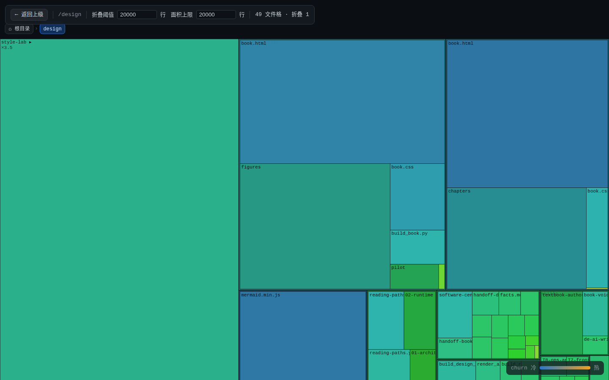
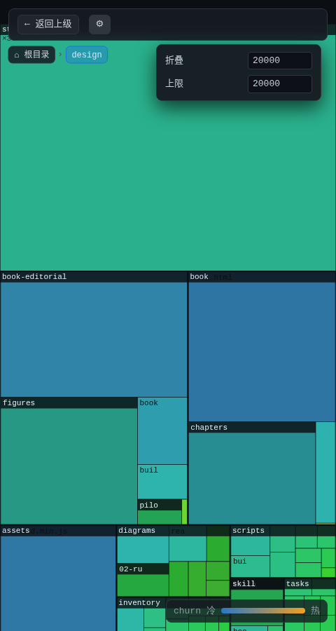
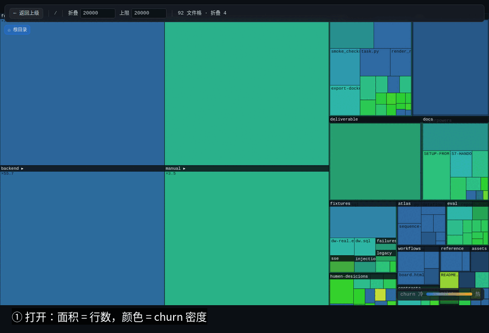
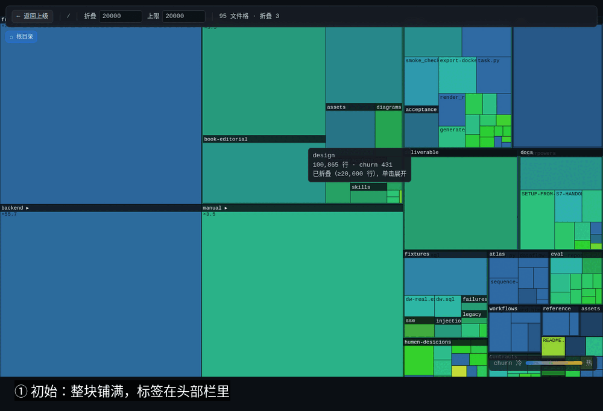
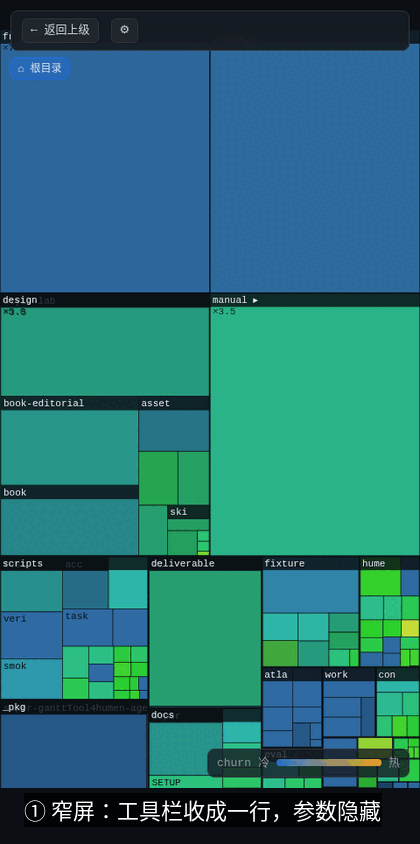

# MatrixTreeMap

用矩形树图看一个仓库：**面积 = 行数，颜色 = churn 密度，大目录自动折叠**。作为 Zed 的伴随窗口，点格子跳回编辑器。



窄屏下工具栏收成一行，参数进 ⚙ 弹层：



Zed 的伴随窗口：把仓库画成**矩形树图**，看体积、看热点、点一下跳回 Zed。

> 为什么不是 Zed 扩展：Zed 的扩展 API 只提供 language / debugger / theme / icon theme / snippets / MCP server / agent server，**没有任何 UI 能力**（官方讨论也明确说近期没有计划扩展视觉能力）。所以侧栏面板做不了，只能做一个伴随窗口。

## 旅程录像

三条片子都是**真实输入**：CDP 发 `mousePressed / mouseMoved / mouseReleased / mouseWheel`，不是截图拼接。

**① 导航**：悬停看数据 → 单击折叠 → 双击下钻 → 点面包屑回退



**② 缩放与平移**：滚轮以光标为中心缩放、拖动平移（位移超过 5px 不算点击）



**③ 窄屏**：工具栏恒一行，参数收进 ⚙ 弹层



MP4 版本在同目录（`demo-*.mp4`），要转发或放 PPT 时用它们，比 GIF 清晰得多。

## 用法

```bash
node server.mjs <仓库目录> [端口]        # 默认 4477
# 打开 http://127.0.0.1:4477
```

无依赖、无构建，Node ≥ 20。

## 口径

| 维度 | 语义 |
|---|---|
| **面积** | 文件行数（按换行符统计；非文本扩展名不计） |
| **面积上限** | 超过 `面积上限` 的块**不再放大**，右上角标 `×倍率`（默认 20000 行） |
| **颜色** | churn **密度**（`git log` 出现次数 / 千行），冷蓝 → 暖橙 |
| **折叠** | 目录行数 ≥ `折叠阈值` 时默认折成一个方块（`▸`），点一下展开；**不做任何排除**，`node_modules` 也在树里，只是被折叠 |

> 颜色为什么用密度而不是原始次数：目录的 churn 是子文件求和，`frontend` 累计上千次，用原值整屏一个颜色，什么也看不出来。面积仍然严格等于行数。

## 交互

| 操作 | 行为 |
|---|---|
| 单击文件 | 在 Zed 打开（优先 `-a` 加到当前窗口，失败退 `-e`，最后 `-n`） |
| 单击目录 | 展开 / 折叠 |
| 双击目录 | 下钻为根 |
| 画布顶部层级块 | 点哪块回到哪一层（`⌂ 根目录 › design › …`） |
| `Esc` / `Backspace` | 回上一层 |
| 滚轮 / 拖动 | 缩放 / 平移（无限画布） |
| ⚙（窄屏 ≤760px） | 折叠阈值与面积上限收进弹层；点是开、点外面或 `Esc` 关 |

### 窄屏

工具栏在任何宽度都是**一行**：≤760px 隐藏重复的路径文字、把两个输入收进 ⚙ 弹层；≤560px 再隐藏统计与分隔符。画布顶部留白按工具栏**实测高度**计算（`getBoundingClientRect` + `ResizeObserver`），不是写死数值。

## 实时

- `fs.watch(recursive)` → 220ms 去抖 → **只更新变化的那一个文件**（不重扫全树）→ SSE 推给浏览器
- churn 要跑 `git log`，代价高：启动扫一次，之后 5 分钟才刷新一次，失败沿用旧值

实测：6281 个文本文件首扫 ~1.5s；新建一个 5 行文件到出现在图上 ~1.2s。

## 结构

```
server.mjs        HTTP + SSE + 文件监听 + /api/open（调 zed）
scan.mjs          扫描 / 行数统计 / git churn / 单文件增量更新
public/index.html 画布渲染（squarified 布局、无限画布、面包屑）
```

## 已知取舍

- 只渲染两层（顶层目录 + 其子项），再深要下钻——三层以上同屏会让每块小到没意义。
- churn 不追踪重命名（`git log --name-only` 的口径）。
- 超大仓库首扫仍会慢；后续可换成「先出布局、再补 churn」的两段式。
